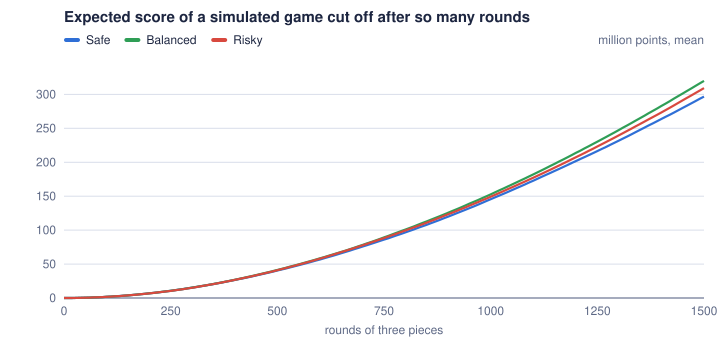
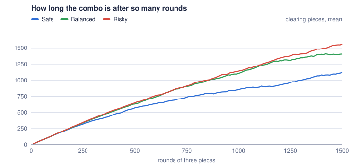
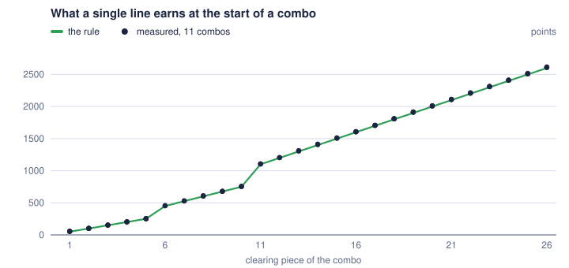
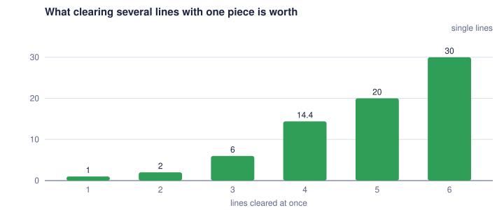
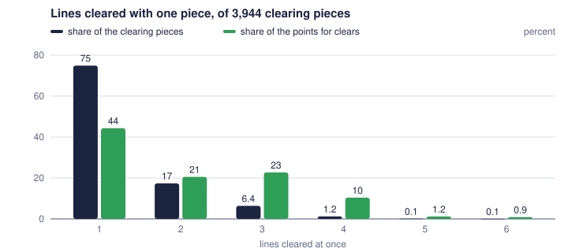
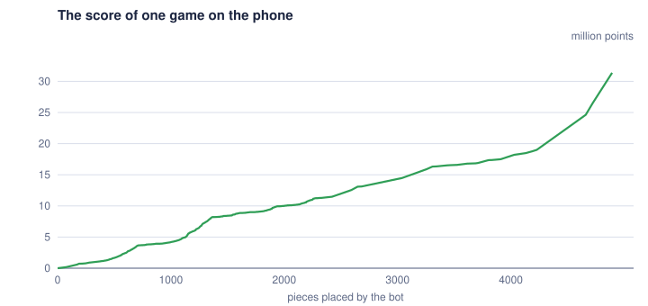
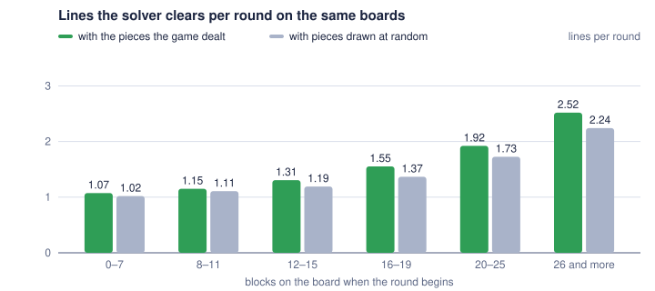
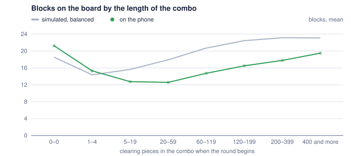

# BBBot

An Android app that plays [Block Blast](https://play.google.com/store/apps/details?id=com.block.juggle)
on its own and tries to reach the highest score it can.

BBBot sits on top of the game: it looks at the screen, works out the board and the three
pieces on offer, decides where they should go and drags them there.

## How it works

```
screenshot ──► recognition ──► solver ──► gestures
    ▲                                        │
    └────────────── next turn ◄──────────────┘
```

- **Screen access and control** go through an Android `AccessibilityService`. It can take
  screenshots, dispatch drag gestures and show a small overlay with a start/stop button on
  top of the game. No root and no PC connection are needed.
- **Recognition** turns a screenshot into the 8×8 board and the pieces in the tray.
- **The solver** tries every order and position for the pieces on offer and rates the
  resulting boards.
- **Every turn starts from a fresh screenshot**, so the bot never relies on what it thinks
  the board should look like.

## Status

| Feature                                   | State   |
|-------------------------------------------|---------|
| Project setup                             | done    |
| Game model and solver                     | done    |
| Accessibility service, overlay, gestures  | done    |
| Board and piece recognition               | done    |
| Play loop                                 | done    |
| Combo strategy                            | done    |
| Stop and take a picture at the end        | done    |
| Lookahead and selectable strategies       | done    |
| Combo rules measured in the game          | done    |
| Score reading and full traces             | done    |
| Measured scoring and a look a round ahead | done    |
| Measured pieces, tray read twice, combo measured in play | done |
| Simulator that deals like the game, evaluation in charts | done |

## Using it

1. Install the app and open it.
2. Switch on "BBBot" in the accessibility settings; the app has a button that leads there.
   The service takes screenshots and performs gestures. It does not read the contents of
   other apps, and the app has no internet permission.
3. Open Block Blast and start a game. A small BBBot panel appears at the bottom of the
   screen, between the pieces and the banner ad, and disappears when the game is left. It
   can be dragged by its text. The bot does nothing until its play button is pressed, so
   the game can be played by hand with the panel there.
4. Choose in the app how the bot should play: safe, balanced or risky (see "Strategies").
   The choice applies the next time the bot is started.
5. Press the play button in the panel. The bot plays until it is stopped with the same
   button, the game is left or the offered pieces do not all fit any more. Touching the
   screen while it plays interrupts the piece it is dragging; it simply tries again.

When the pieces no longer fit, the bot stops without placing what still would, and saves a
screenshot of the board and the score (`final-<strategy>-…`), so the end of every game can be
looked at afterwards. Every run is also added to `runs.csv` in the same folder, with the
strategy, the reason it ended (`no_room` or `stopped`), the pieces placed, the lines cleared,
the seconds it took, the score at its start and at its end, and the names of the screenshot
and of the trace. A run that was cut short, by a new version being installed for example, is
added as `interrupted` the next time the bot plays, as far as it had got twenty seconds
before its end at the latest.

"Measure exactly" in the app makes the bot wait after every clear until the score stands
still. The game counts the score up over several seconds, so without that wait the trace
cannot tell what a single piece earned. With it the bot needs five to six seconds per clear,
so it is switched off unless asked for; four and more lines at once, which are rare and
not measured often enough, are waited for either way.

### Traces

Every run leaves a trace, `trace-<start>/moves.csv`, with a line per piece placed and a small
picture of the score before each piece. It is there to find out what the game pays for. A
line holds, as things were before the piece:

- the board, the pieces on offer and the one that is placed with its position; boards and
  pieces are hexadecimal numbers with one bit per cell, the top left cell being the lowest,
- what is expected of the piece: the lines it clears, and whether it empties the board,
- whether the pieces on offer could clear anything at all,
- the combo as the bot counts it, and whether the round has had its clear,
- how much of the combo symbol behind the score is on the screen,
- the score read off the screen, and whether the look before showed the same score.

What a piece earned is the score of the next line minus the score of its own, when both
stood still. The last line of a run that ended because the pieces did not fit has no piece;
it holds the final score. The newest thirty traces are kept.

`tools/analyze_traces.py` turns traces into answers: what a clear of one, two or three lines
is worth, how that grows with the combo, what the first clear after a lost combo earns, and
which pieces the game hands out how often.

```sh
adb pull /sdcard/Android/data/io.github.andreasscholz.bbbot/files/captures captures
python tools/analyze_traces.py captures/trace-*
```

The score is read by `ScoreReader`: the digits are what has the most common bright color in
the strip where the score stands, and each is compared to a pattern made from screenshots
with known scores. It gives no score rather than a doubtful one, and the play loop drops a
score that fell or leapt.

The camera button in the panel saves what the bot sees as a PNG in
`Android/data/io.github.andreasscholz.bbbot/files/captures/` on the phone, where the `final-…`
pictures go as well. The bot also saves a picture there on its own when it cannot make sense
of the screen for a while (`unreadable-…`) or when the game keeps refusing a move
(`rejected-…`). These pictures are what the recognition is developed and tested against:

```sh
adb pull /sdcard/Android/data/io.github.andreasscholz.bbbot/files/captures
```

## Recognition

The game changes its colors with its themes, so `ScreenReader` knows no colors. It assumes
only this much:

- the background reaches the left edge of the screen; the color there is the background of
  that row of pixels. How far a pixel may stray from it and still be background is measured
  on the left edge of each screenshot, because plain wood needs little room and veined marble
  a lot,
- the board is the tallest band that is not background almost all the way across, and it is
  square,
- the darkest cell of the grid is an empty one, and every cell that looks different from it
  holds a block,
- the offered pieces lie below the board, one in each third of the screen, drawn at a fixed
  fraction of the board's scale.

Screens that do not fit (menus, ads, a line being cleared, pieces still flying in) are
reported as "no game", and the bot simply looks again.

The unit tests read real screenshots from `app/src/test/resources/screens`, taken on a
1080×2400 phone in the wooden, the marble, the pink and the purple theme. The themes differ
in more than colors: the border of the board and the shadows of the pieces have different
widths, which is why the border is measured in each screenshot.

## Moving a piece

The game does not keep a dragged piece under the finger. A touched piece jumps up by about
2.25 board cells, and from there it moves one and a half times as far as the finger does.
Where the piece is grabbed makes no difference. `DragPlan` works backwards from the cells the
piece should cover to the point where the finger has to be lifted. These numbers were
measured in the game by holding pieces in the air and comparing screenshots.

## The play loop

`Player` looks, thinks and moves one piece at a time. After a drag it waits until the screen
shows the board it expects, or until two looks in a row agree, so that it does not plan on
a board whose lines are still vanishing. A piece that slipped back into the tray is simply
tried again on the next turn.

When the pieces offered no longer all fit, the bot stops and places nothing more, also not
what would still fit: the last pieces are left to the user. With "Endless" switched on in
the app it places what still fits instead, which ends the game, and goes on as soon as it
sees a game again. It does not get there by itself yet: what the game shows between two
games, ads among it, is not known, so for now the bot keeps pictures of it (`after-…`) and
taps nothing there.

When the game was started anew and waits in its main menu, the bot taps "Classic" to go on
with the game. That is the only thing it taps that is not a piece.

While the notification shade, the lock screen or anything else of the system may lie on top
of the game, the bot keeps no picture of the screen and taps nothing. It goes on when it
sees the game again.

The score is read on every look. A reading that fell or leapt by more than two million is
taken for misread, unless the next one agrees with it: in a long combo a single clear can
earn that much. The combo as the bot counts it is kept across runs, so that a new version
can be installed in the middle of a game.

## The solver

The board is a 64-bit number, one bit per cell, so placing a piece and finding full rows and
columns are a handful of bit operations. For the pieces on offer the solver walks through
every order and every position (at most 6 · 64³ sequences) and rates the board each sequence
ends with:

- empty cells are good,
- edges between filled and empty cells are bad, which keeps the board compact,
- single empty cells enclosed on three or four sides are bad,
- room for a 3×3 square and for lines of five is good, because those are the pieces that end
  games,
- cleared rows and columns give a small bonus on top.

The best 64 sequences then get a closer look, which is too slow to give to all of them: every
shape the game knows is tried in every position on the board a sequence leaves, and the board
is rated by how good it still is after that next piece, on average over the shapes.

If the pieces cannot all be placed, the bot stops instead of placing what still fits.

### Combos

Nearly all points come from long combos. The game publishes no rules, so these were read off
traces of real games (see "Traces" below):

- A combo lasts as long as every round, the three pieces offered together, clears at least
  one line. A round without a clear ends it, also when no clear was possible with its pieces.
  Three pieces in a row without a clear do no harm as long as they belong to two rounds.
- The game draws a symbol behind the score while a combo runs, and takes it away when the
  combo ends.
- A clear earns more the longer the combo is, by orders of magnitude: in one game a single
  line was worth about 9,000 points with a long combo and about 10 right after it ended.
- The combo counts pieces that cleared something, not lines. A single line earns the length
  of the combo times a step: 50 points for the first five pieces of a combo, 75 for the next
  five and 100 from the eleventh on. So the first clears of a combo earn 51, 101, 151, 201 and
  251 points, the sixth 452, the eleventh 1,104, and from there every clearing piece adds
  100.33 to what a line is worth; 105 single clears in a row lay within a point of that line.
  An earlier game paid 76.10 per step for a long combo. Why is not known.
- Two lines at once earn exactly twice a single line, three lines six times. Four lines
  earned 14.4 single lines, measured twelve times between 14.2 and 14.4; five earned 19.95
  and six 29.96, each measured once. Six is the most one piece can clear: three rows and
  three columns with a 3×3 square, or five and one with a line of five. Of 6552 pieces
  placed, 2279 cleared one line, 554 two, 198 three, 32 four, 2 five and 1 six.
- A block placed earns a point, which reaches the score a second or two late.
- A piece that empties the board earns 300 points on top of its clear, and nothing else
  changes: in one game the board was emptied eight times, at combos between 30 and 190
  pieces long, and each time the clear earned 298 to 300 points more than its place in the
  combo, while the clears before and after it lay on the same straight line. The symbol the
  game shows after an emptied board is no multiplier. With a long combo, where a single
  line earns thousands of points, emptying the board is worth next to nothing.

### The pieces

The game does not hand out all shapes equally often, and which ones it hands out depends on
the board. Counted in 2117 rounds, 6227 pieces (`PieceCatalog` has the list):

| Blocks on the board | 0–9    | 10–14  | 15–19  | 20 and more |
|---------------------|--------|--------|--------|-------------|
| 3×3 square          | 10.0 % | 10.1 % | 14.4 % | 14.2 %      |
| 2×2 square          | 5.8 %  | 7.1 %  | 8.3 %  | 10.7 %      |
| All rectangles      | 22 %   | 29 %   | 34 %   | 37 %        |
| Straight lines      | 19 %   | 19 %   | 20 %   | 20 %        |
| Bent shapes         | 59 %   | 52 %   | 46 %   | 43 %        |

The fuller the board, the more compact rectangles come up and the fewer of the bent shapes.
Single blocks and the lines of two and three hardly come up at all.

Beyond that, the pieces suit the board they are dealt onto. That showed when the solver
played the same 2107 boards twice, once with the three pieces the game dealt and once with
pieces drawn at random with the counted frequencies (`DealLab` in the unit tests):

- Every round dealt could be placed completely. Of the drawn rounds one in 130 could not,
  and on boards with 26 blocks and more one in ten. It is no guarantee, though: a game ended
  on a board with 43 blocks with a 3×3 square that had no place at all.
- With the pieces dealt the solver cleared an eighth more lines, and on boards with 16 to 19
  blocks a fifth more. So the board empties faster than chance would have it.
- A round that could not clear anything was dealt 18 times, where 15 were to be expected
  from drawn rounds. In that the game is neither kind nor unkind.

How the game does it is not known. The simulator imitates it: shapes are drawn with the
frequencies for the board's fill, a round is drawn again until it can be placed, and from a
dozen blocks on the round is the best of five by the lines it can clear, unless the first of
them cannot clear anything. That was fitted to the numbers above and is not the game's rule.

The solver plays by that:

- A combo has a worth, small when it begins and growing with every piece that cleared
  something, up to a limit. Ending a round without a clear costs that worth.
- A board costs the worth times the chance that the next round clears nothing. What the
  first piece of that round can do is read off the board, as the share of all shapes that
  could clear something at once. The two pieces after it can be set up for and get a chance
  of at least 30 %.
- A piece that clears something gets a small bonus however many lines it clears, so that two
  pieces clearing a line each are preferred to one clearing two.

The bot counts the combo itself. Started in the middle of a game it can only see that a
combo is running, and takes it to be 100 long. Working the length out from what a clear
earns was tried and dropped: the score counts up late and in stages, so there is no telling
when it has taken a clear in, and the results were nonsense (a combo of 1 right after sixty
clears). The same measurement early in a game gave 61 where 45 pieces had cleared something
and 64 lines had been cleared, which does not fit the step per piece measured late in a
game; how the worth of a line grows at the start of a game is still open.

New pieces grow into place, and a look in the middle of that reads them wrong: in traces one
round in twelve began with such a reading, and one of them cost a combo of a thousand,
because the solver planned a clear with a piece that was not there. A round now only begins
once two looks in a row show the same three pieces.

### Strategies

The limit up to which a combo gains in worth is the setting that the three strategies in the
app differ in. In 384 simulated games each, of 1500 rounds of three pieces:

| Strategy | Limit | Points per game | Rounds per lost combo | Blocks on the board | Games ended early |
|----------|-------|-----------------|-----------------------|---------------------|-------------------|
| Safe     | 5×    | 278 million     | 896                   | 21.8                | 5                 |
| Balanced | 11×   | 312 million     | 1245                  | 23.9                | 2                 |
| Risky    | 25×   | 304 million     | 1273                  | 25.5                | 8                 |

Balanced scores best. Risky keeps the board fuller for no more points, safe gives a combo
up sooner. The charts are under "Evaluation" below.

A combo is worth three times what it was until version 0.8.5. That came out of the
simulator dealing its pieces the way the game does: such a game hardly ever ends, so a
fuller board is less of a danger than it seemed, and points come from not losing the combo.
What counts is the most a combo can come to be worth, its worth at the start times the
limit. In 288 games each of 1000 rounds:

| Most a combo is worth | 40 | 70 | 110 | 180 | 220 | 330 | 550 | 1100 |
|-----------------------|----|----|-----|-----|-----|-----|-----|------|
| Million points        | 38 | 71 | 100 | 121 | 133 | 139 | 134 | 138  |

Up to 0.8.5 balanced stood at 110; it is now at 330, where the gain levels off.

The weights of the board rating were tried against the new simulator one by one, each at
about half and at about twice its value. One made a difference beyond chance: an empty cell
counts half of what it did, which brought 7 % more points. Weighing the shapes to expect
next by the board's fill, as the game deals them, brought nothing.

`StrategyLab` in the unit tests is the tool these numbers come from:

```sh
BBBOT_LAB=1 ./gradlew :app:testDebugUnitTest --rerun --tests '*StrategyLab*' -i | grep LAB
```

With `BBBOT_LAB_OUT` set to a folder it also writes, per strategy, how the games stood after
every round and how each one ended, to draw charts from.

Also tried there, against an earlier simulator that drew its pieces blindly, and left out
because it did not help or made things worse:

- trying the best sequences against whole rounds drawn at random and counting in how many a
  line can be cleared and in how many the pieces do not fit (`RoundSampler`, switched off).
  Against pieces drawn evenly it made games 11 % longer and brought 11 % more points; against
  pieces drawn the way the game draws them it made games shorter, and against the simulator
  that deals like the game it brought 6 % fewer points,
- more weight on room for the 3×3 square, although it is the most common piece (shorter
  games),

- a fixed penalty for a board without room for a 3×3 square or a line of five, on top of the
  gradual rating of that room (games got about a tenth shorter),
- a penalty for every shape that fits nowhere (no effect),
- rating a board by the shape that turns out worst instead of the average (no effect),
- more reward for clearing several lines at once (shorter games, fewer points),
- a strong preference for clearing one line at a time (the board suffers; a small one is in),
- going after three lines at once because they pay six times a single line, with a larger
  reward for them or one that grows with the combo (no gain; the combo gets shorter),
- not counting a round against the combo when its pieces could not clear anything, after it
  looked that way in one game (the traces showed the combo ending all the same),
- more than 64 sequences for the closer look (no effect beyond 64).

## Evaluation

What is known about the game and the bot, in charts. They are drawn by `tools/charts.py` from
the traces of the phone and from simulated games, and are redrawn when there is something
new:

```sh
adb pull /sdcard/Android/data/io.github.andreasscholz.bbbot/files/captures captures
BBBOT_LAB=1 BBBOT_LAB_GAMES=384 BBBOT_LAB_ROUNDS=1500 BBBOT_LAB_OUT=lab-out \
    ./gradlew :app:testDebugUnitTest --rerun --tests '*StrategyLab*'
BBBOT_DEALS=captures BBBOT_DEALS_OUT=deals.csv \
    ./gradlew :app:testDebugUnitTest --rerun --tests '*DealLab*'
python tools/charts.py --lab lab-out --traces captures --deals deals.csv
```

### What the strategies score



| Million points after | 100 | 250 | 500  | 1000  | 1500 rounds |
|----------------------|-----|-----|------|-------|-------------|
| Safe                 | 1.7 | 10.3 | 38.9 | 138.3 | 278.1      |
| Balanced             | 1.7 | 10.3 | 40.3 | 148.3 | 312.5      |
| Risky                | 1.7 | 10.1 | 38.9 | 144.1 | 303.9      |

The score grows faster than the rounds, because a clear earns the more the longer the combo
is and the combo grows with every round. Up to 250 rounds the strategies do not differ;
after that the one that loses its combo less often pulls ahead.



These are simulated games. They rank the strategies; the points on the phone depend on how
well the simulator imitates the game, see "Simulated and real games" below.

### What a clear earns



A single line earns the length of the combo times 50 points for the first five clearing
pieces of a combo, times 75 for the next five and times 100 from the eleventh on, without a
limit.



Measured 388, 97, 31, 12, 1 and 1 times. Six lines is the most one piece can clear.



Three lines at once are rare and still earn as much as all clears of two lines together.

### A game on the phone



Flat stretches are the beginnings of combos, steep ones long combos. This game was played
with several versions of the bot, so it is not a clean run of one strategy.

### Simulated and real games

Until version 0.8.5 the simulator drew its pieces blindly, and its games differed from the
real one in two ways: half of them were over after 250 rounds, where a real game was still
running after a thousand, and they lost their combo once in 159 rounds, where the real game
lost it once in 46. The reason for the first is how the game deals:



On the same boards and with the same solver, the pieces the game dealt cleared more lines
than pieces drawn at random, the more so the fuller the board. With pieces that suit the
board, the board stays emptier and the game goes on. The simulator now deals that way (see
"The pieces" above), and its games hardly ever end either.

The reason for the second was mostly the solver, not the game. Of 46 rounds without a
clear, 28 had pieces that could have cleared a line, and 19 of those came at a combo of
less than 20 pieces, which the solver held too cheap to pay for with the board. A combo is
now worth three times as much to it.



How full the bot keeps the board depends on what the combo is worth to it. The dots are
from games on the phone played with the old worth of a combo, the line is simulated with
the new one, so the line lies higher. With the old worth the simulator kept 14 to 19 blocks
where the phone had 13 to 20.

On the phone the new worth of a combo did what the simulator said it would. In the first
339 rounds played with it the combo was lost twice, once with pieces that could not clear
anything, where it had been lost once in 46 rounds before; the board held 20.5 blocks on
average, where the simulator has 23.9; and the score went from 130 to 180 million.

The same shows when the 28 rounds that lost a combo although a line could have been cleared
are played again by the solver: with the old weights it clears a line in 6 of them, with
the new ones in 24.

What the simulator still gets wrong: on the phone a young combo of 5 to 19 pieces was lost
in one round of 17, in the simulator, with the same solver, in one of 50. So the pieces the
game deals onto a nearly empty board are harder to clear with than the simulator's.

## Building

Requirements: JDK 17 or newer and the Android SDK (path in `local.properties` as `sdk.dir`).

```sh
./gradlew :app:assembleDebug        # APK: app/build/outputs/apk/debug/app-debug.apk
./gradlew :app:testDebugUnitTest    # JVM unit tests
```

## Development

Every feature is developed on its own branch and merged into `main` when it is finished.

## Disclaimer

A private hobby project, not affiliated with the makers of Block Blast. Automating a game
may be against its terms of service; use it at your own risk.
